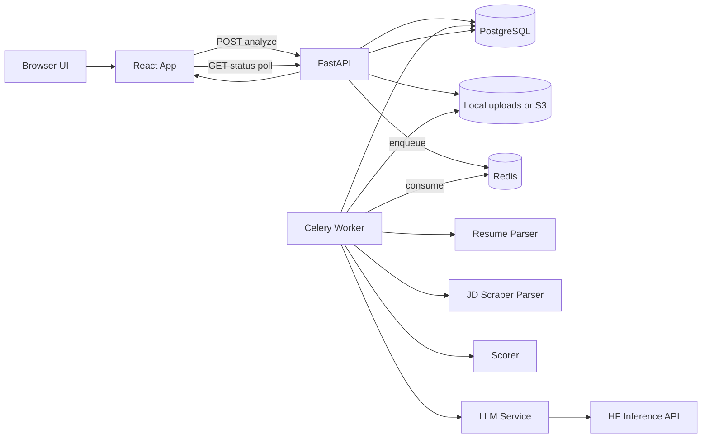

# IntelliCover AI

## 1) What This Product Does

IntelliCover AI takes:
1. Resume PDF
2. Job description URL

And returns:
1. Parsed resume information
2. Parsed job description information
3. ATS alignment score (with component breakdown)
4. Skill gap suggestions
5. AI-generated personalized cover letter

The key design choice in this system is asynchronous processing. Heavy NLP and LLM work does not run inside the HTTP request thread. It runs in a Celery worker process.

---

## 2) Technology Stack and Why It Is Used

## 2.1 Frontend
- React + Vite
  - Fast development and modular UI component architecture
- TanStack Query
  - Handles polling and async server state cleanly
- Zustand
  - Lightweight global auth state
- Axios
  - HTTP client with centralized auth header and error interceptors

Why this works well:
- Dashboard can poll status safely until background job is complete
- Components stay focused on rendering while hooks handle data lifecycle

## 2.2 Backend API
- FastAPI
  - Fast async web framework with clear dependency injection
- Pydantic
  - Strong request/response schema validation
- SQLAlchemy Async
  - Async DB access in API server
- PostgreSQL
  - Durable storage for users, jobs, scores, cover letters

Why this works well:
- Strong API contracts with schemas
- Async DB sessions per request
- Clear separation between API layer and worker layer

## 2.3 Background Processing
- Celery
  - Task queue worker for long-running analysis and generation
- Redis
  - Broker/result backend for Celery
- Synchronous SQLAlchemy in worker
  - Worker process uses sync DB engine to avoid async event loop complexity in Celery task execution

Why this works well:
- HTTP requests return quickly
- Heavy operations can retry and fail independently
- Easier to scale by increasing worker count

## 2.4 NLP and AI
- PyMuPDF (fitz)
  - Extract text from resume PDFs
- BeautifulSoup + httpx + Playwright fallback
  - Scrape and clean job descriptions from websites
- spaCy
  - Lightweight NER assistance and text heuristics
- sentence-transformers
  - Semantic similarity for responsibility-to-experience matching
- Hugging Face Inference API
  - Suggestions and cover letter generation via hosted models

Why this works well:
- Structured extraction from unstructured inputs
- Explainable score from deterministic components
- LLM used where generation quality is needed

---

## 3) System Architecture in One View

Simple summary:
- API receives and stores input
- Worker performs analysis
- UI keeps polling status endpoint
- UI renders final outputs when status becomes SUCCESS

---

## 4) End-to-End Request Lifecycle (Exact Flow)

## Step 1: User submits data
Frontend file:
- frontend/src/pages/HomePage.jsx

The submit button triggers:
- jobsApi.submitAnalysis(file, url)

API client file:
- frontend/src/api/client.js

This sends multipart form data to:
- POST /api/v1/jobs/analyze

## Step 2: API validates and enqueues
Backend file:
- backend/app/api/v1/jobs.py
- function: submit_analysis

It does this in order:
1. Validate content type is PDF
2. Validate max size is 10MB
3. Generate storage key
4. Save uploaded file (local or S3)
5. Insert AnalysisJob row with status PENDING
6. Dispatch Celery task run_analysis_task.delay(job_id)
7. Save celery_task_id in DB row
8. Return 202 with job_id immediately

Important idea:
- API never waits for NLP/LLM processing

## Step 3: Frontend starts polling
Frontend files:
- frontend/src/pages/DashboardPage.jsx
- frontend/src/hooks/useJobPolling.js

Hook behavior:
1. Call GET /api/v1/jobs/{job_id}/status every 3 seconds
2. Stop automatically when status is SUCCESS or FAILURE

UI state map:
- PENDING/IN_PROGRESS -> ProcessingSteps view
- SUCCESS -> score cards + suggestions + cover letter controls
- FAILURE -> error view with retry option

## Step 4: Worker runs analysis pipeline
Worker file:
- backend/app/worker/tasks.py
- function: run_analysis_task

Execution order:
1. Set job IN_PROGRESS
2. Resolve file path from storage key
3. Load spaCy model (or regex fallback)
4. Parse resume
5. Scrape JD text
6. Parse JD
7. Save parsed_resume and parsed_jd JSON to DB
8. Run scoring pipeline
9. Generate suggestions with LLM
10. Save score fields + suggestions + SUCCESS
11. On exception save FAILURE + error message

## Step 5: API status endpoint returns results
Backend file:
- backend/app/api/v1/jobs.py
- function: get_job_status

This endpoint:
1. Confirms job belongs to authenticated user
2. Returns status and timestamps always
3. Returns structured data when SUCCESS

## Step 6: Cover letter flow (second async pipeline)
Dashboard file:
- frontend/src/pages/DashboardPage.jsx

When user clicks Generate Cover Letter:
1. POST /api/v1/jobs/{job_id}/generate-cover-letter
2. API checks job is SUCCESS and belongs to user
3. Creates CoverLetter row PENDING
4. Dispatches run_cover_letter_task
5. Frontend polls GET /api/v1/jobs/{job_id}/cover-letter/status
6. On SUCCESS, show cover letter text in editor

---

## 5) File-to-File Call Chain (Traceable)

Analysis chain:
1. frontend/src/pages/HomePage.jsx
2. frontend/src/api/client.js
3. backend/app/api/v1/jobs.py submit_analysis
4. backend/app/services/storage_service.py
5. backend/app/worker/tasks.py run_analysis_task
6. backend/app/nlp/spacy_loader.py
7. backend/app/nlp/resume_parser.py
8. backend/app/nlp/jd_scraper.py
9. backend/app/nlp/scorer.py run_scoring_pipeline
10. backend/app/nlp/llm_service.py generate_suggestions
11. backend/app/api/v1/jobs.py get_job_status
12. frontend/src/hooks/useJobPolling.js
13. frontend/src/pages/DashboardPage.jsx
14. frontend/src/components/ATSScoreCard.jsx and other panels

Cover letter chain:
1. frontend/src/pages/DashboardPage.jsx (button)
2. frontend/src/api/client.js generateCoverLetter
3. backend/app/api/v1/jobs.py generate_cover_letter
4. backend/app/worker/tasks.py run_cover_letter_task
5. backend/app/nlp/llm_service.py generate_cover_letter
6. backend/app/api/v1/jobs.py get_cover_letter_status
7. frontend/src/hooks/useJobPolling.js useCoverLetterPolling
8. frontend/src/components/CoverLetterEditor.jsx

---

## 6) ATS Score Calculation - Exact Logic and Formula

Main file:
- backend/app/nlp/scorer.py

Weights:
- Hard skill match = 50%
- Semantic experience match = 40%
- Education match = 10%

Formula:

$$
TotalATS = (HardSkill \times 0.50) + (Semantic \times 0.40) + (Education \times 0.10)
$$

All component scores are clamped into [0, 100] before aggregation.

## 6.1 Hard skill score
Function:
- calculate_hard_skill_score

Inputs:
- resume_skills
- jd_required_skills

Method:
1. Normalize strings
2. Compare JD required skills against resume skill set
3. Compute overlap percentage

Math:

$$
HardSkill = \frac{matched\_jd\_skills}{total\_jd\_required\_skills} \times 100
$$

Outputs:
- score
- matched_skills list
- missing_skills list

## 6.2 Semantic score
Functions:
- calculate_semantic_score
- SemanticMatcher.compute_similarity

Inputs:
- jd responsibilities list
- resume experience descriptions

Method:
1. Encode all JD responsibilities to vectors
2. Encode all resume experience items to vectors
3. Compute cosine similarity matrix
4. For each JD responsibility, keep best matching resume similarity
5. Average these best scores, multiply by 100

Math:

$$
cos(a,b)=\frac{a\cdot b}{||a||\,||b||}
$$

$$
Semantic = \left(\frac{1}{n}\sum_{i=1}^{n} \max_j cos(r_i, e_j)\right) \times 100
$$

Strong vs weak responsibility threshold:
- strong if similarity >= 0.65
- weak if similarity < 0.65

## 6.3 Education score
Function:
- calculate_education_score

Method:
1. Detect required level from JD text keywords
2. Detect candidate highest level from resume education entries
3. Score by rule:
- meets/exceeds -> 100
- one level lower -> 60
- significantly lower -> 20
- no JD requirement -> 80
- no resume education -> 50

## 6.4 Aggregation
Function:
- aggregate_scores

Method:
1. Clamp each component to [0,100]
2. Weighted sum
3. Clamp total to [0,100]
4. Return ScoringBreakdown object

---

## 7) NLP Processing Details (What Exactly Is Done)

## 7.1 Resume parsing
File:
- backend/app/nlp/resume_parser.py

Pipeline:
1. extract_text_from_pdf using PyMuPDF
2. Regex extract email and phone
3. Split into sections by heading heuristics
4. Skills extraction:
   - seed skill dictionary matching
   - optional spaCy entity pass
5. Experience extraction:
   - block split by blank lines
   - infer title/company/duration heuristically
6. Education extraction:
   - infer degree/institution/year heuristically
7. Build ParsedResumeSchema

Why useful:
- Converts unstructured PDF to structured fields needed for scoring and prompts

## 7.2 Job description scraping and parsing
File:
- backend/app/nlp/jd_scraper.py

Pipeline:
1. Tier 1 scrape with httpx + BeautifulSoup
2. If insufficient and enabled, fallback to Playwright browser rendering
3. Remove noisy HTML tags
4. Preserve list and heading structure
5. Split into logical sections
6. Extract required/preferred skills
7. Extract responsibilities list
8. Infer title and company
9. Build ParsedJDSchema

Special retry mode:
- If URL value starts with text:, scraper bypasses web request and uses provided raw text directly

Why useful:
- Handles both simple and JavaScript-heavy job pages

## 7.3 spaCy model loading strategy
File:
- backend/app/nlp/spacy_loader.py

Behavior:
1. Lazy singleton load
2. Return cached model after first load
3. If model missing, return None and continue in degraded mode

Why useful:
- Avoids repeated load overhead
- Improves resilience in local environments

---

## 8) LLM Generation Architecture

File:
- backend/app/nlp/llm_service.py

Two generation tasks:
1. Suggestions
2. Cover letter

## 8.1 Suggestions
Method:
- generate_suggestions

How it works:
1. Build a structured prompt including:
   - JD title, skills, responsibilities, full text
   - resume skills and experience summary
   - missing skills and weak responsibilities
2. Call HF router endpoint (OpenAI style chat payload)
3. Parse bullet-like output into clean list

## 8.2 Cover letter
Method:
- generate_cover_letter

How it works:
1. Build prompt with resume and JD context
2. Generate longer response (higher token budget)
3. Post-process output:
   - remove extra notes/disclaimer garbage
   - remove markdown headings and emphasis artifacts

## 8.3 Reliability
Client behavior includes:
- retry on 503 and 429
- timeout handling
- fallback to text-generation endpoint for non-chat model behavior
- explicit 401 and 403 diagnostics

---

## 9) Data Model and State Management

Main ORM file:
- backend/app/models/db_models.py

Tables:
1. users
2. analysis_jobs
3. cover_letters

Status constants:
- PENDING
- IN_PROGRESS
- SUCCESS
- FAILURE

analysis_jobs stores:
- input pointers (resume key, url)
- parsed_resume JSON
- parsed_jd JSON
- component scores and total ATS
- suggestions
- error message if failed

cover_letters stores:
- generated text
- status and error
- relation to analysis job

Why this schema is useful:
- supports polling
- supports audit/debug traces
- keeps both intermediate and final artifacts

---

## 10) Authentication and Security Flow

Files:
- backend/app/core/security.py
- backend/app/services/auth_dependency.py
- backend/app/api/v1/auth.py
- frontend/src/api/client.js

Flow:
1. Register hashes password with bcrypt
2. Login verifies bcrypt and returns JWT
3. Frontend stores token and sends Authorization header automatically
4. Protected endpoints decode JWT and fetch active user
5. Job queries are filtered by user id to enforce data isolation

Security controls currently present:
- password hashing
- JWT expiry
- auth required on job routes
- file type and size validation
- storage key sanitization

---

## 11) Frontend Rendering Workflow in Detail

Main orchestration page:
- frontend/src/pages/DashboardPage.jsx

Render logic:
1. Initial loading skeleton
2. Error fallback if no job access
3. Processing view when status in PENDING or IN_PROGRESS
4. Failure view when status FAILURE with retry form
5. Success view with:
   - ATSScoreCard
   - KeywordMatchPanel
   - SuggestionsPanel
   - CoverLetterSection

ATSScoreCard behavior:
- Circular SVG gauge
- animated score reveal
- color by score band
- per-component bars from breakdown object

Polling stops automatically once terminal state is reached.

---

## 12) Code Walkthrough of Critical Functions

This section gives practical block-by-block explanation of key functions.

## 12.1 submit_analysis (jobs API)
File:
- backend/app/api/v1/jobs.py

Block explanation:
1. Input validation block guards invalid files early
2. Storage block writes file and returns storage key
3. DB block creates PENDING job row
4. Task dispatch block enqueues Celery job
5. Response block returns job id immediately

Why this function is designed this way:
- keeps user request fast and fault-tolerant

## 12.2 run_analysis_task (worker)
File:
- backend/app/worker/tasks.py

Block explanation:
1. status transition block marks IN_PROGRESS
2. resume block resolves and parses PDF
3. JD block scrapes and parses text
4. persistence block saves parsed artifacts
5. scoring block computes ATS and gaps
6. suggestion block generates AI recommendations
7. final persistence block writes SUCCESS + outputs
8. exception block captures and persists FAILURE details

Why this function is designed this way:
- one orchestrator controls full pipeline lifecycle

## 12.3 run_scoring_pipeline
File:
- backend/app/nlp/scorer.py

Block explanation:
1. compute hard skill component
2. compute semantic component
3. compute education component
4. aggregate weighted final score
5. produce gap object

Why this function is designed this way:
- deterministic and explainable scoring with modular components

## 12.4 useJobPolling
File:
- frontend/src/hooks/useJobPolling.js

Block explanation:
1. query key binds cache to job id
2. query function requests status endpoint
3. dynamic polling interval checks terminal state
4. returns false interval once complete to stop requests

Why this function is designed this way:
- efficient backend usage and smooth UX

---

## 13) Error Handling and Recovery Paths

## API layer
- global exception handler in backend/app/main.py logs traceback and returns safe 500 payload

## Worker layer
- task-level try/except saves failure details to DB
- Celery retry behavior configured

## Scraper layer
- httpx first
- Playwright fallback
- manual text retry option via /retry endpoint

## Frontend layer
- explicit loading, failure, and retry UI states
- 401 interceptor redirects to login

---

## 14) Debugging Guide (Most Useful Checks)

If ATS score looks incorrect:
1. Inspect parsed_resume.skills
2. Inspect parsed_jd.required_skills
3. Verify semantic input lists are non-empty
4. Confirm sentence transformer model is available
5. Check weights in scorer.py

If analysis keeps failing:
1. Check worker logs first
2. Check scraping errors (blocked URL, JS-heavy page)
3. Check HF token and model access permissions
4. Check DB error_message field in analysis_jobs

If dashboard keeps loading forever:
1. Verify status endpoint response has terminal state
2. Verify worker has processed the queue
3. Verify frontend polling hook is enabled with valid job id

If cover letter fails:
1. Verify analysis job is SUCCESS
2. Verify cover_letter row status and error message
3. Verify HF request health and timeout behavior

---

## Final Mental Model

Think of this project as two systems working together:
1. Real-time API and UI system (fast, responsive)
2. Background AI processing system (heavy, asynchronous)

The API records and dispatches work.
The worker computes and writes results.
The frontend polls and renders state transitions.

That is the full end-to-end architecture and workflow of IntelliCover AI.
